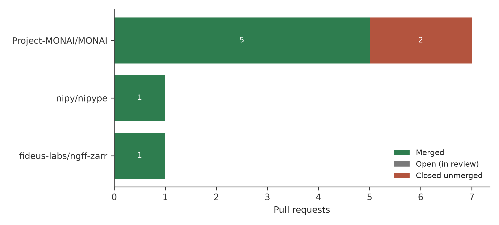
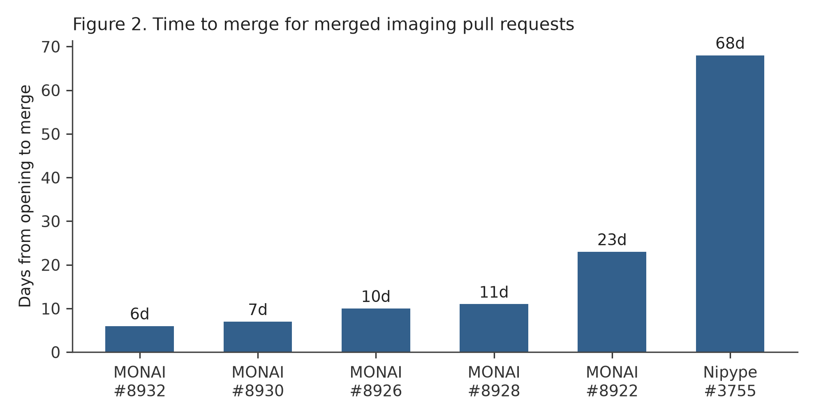
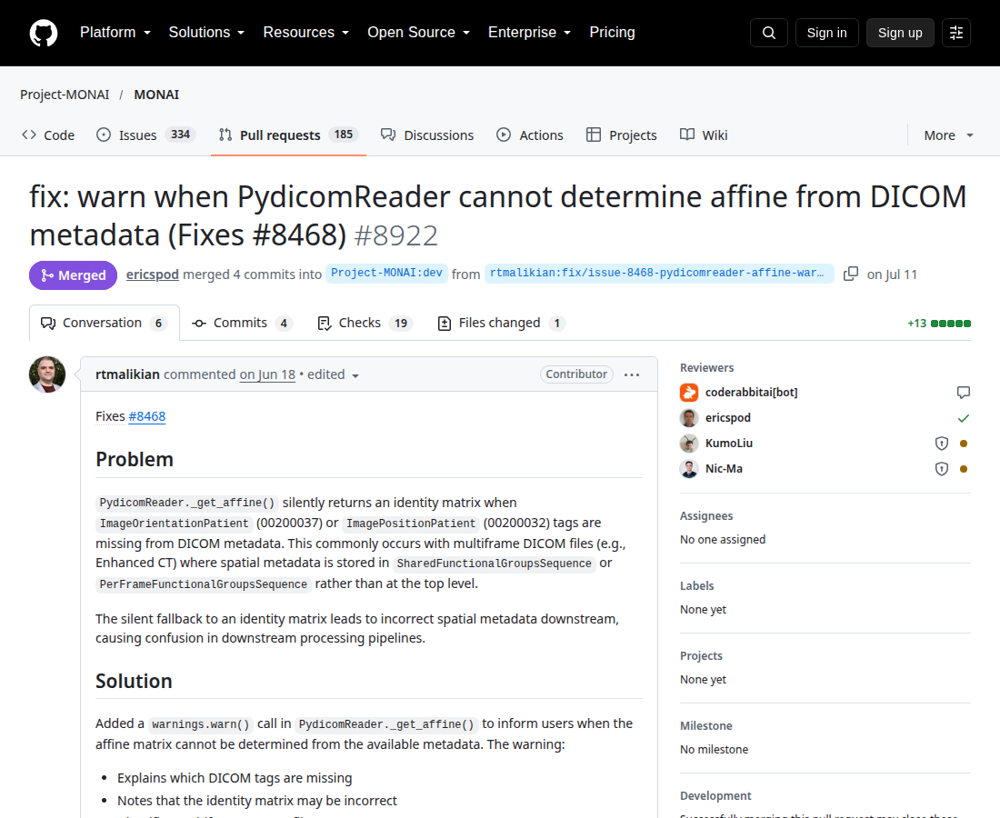

# 📄 Download the full article — PDF

[](https://github.com/rtmalikian/medical-imaging-dicom-open-source-reliability/raw/main/article2-medical-imaging.pdf)

### 👉 [**Click here to download the PDF**](https://github.com/rtmalikian/medical-imaging-dicom-open-source-reliability/raw/main/article2-medical-imaging.pdf)

*One click — no sign-up, no paywall. The full text is also embedded in this README below.*

---

# Silent Failures in the Imaging Stack: A Retrospective Analysis of Open-Source Contributions to Medical Imaging Software: DICOM Geometry, Warnings Discipline, and Pipeline Reliability (2025-2026)

**Author:** Raphael T. Malikian, MBBS BSc (Hons), Independent Researcher, Palmdale, California, USA
**Profile:** https://github.com/rtmalikian

[](https://doi.org/10.5281/zenodo.23549102)
**Preprint:** [Zenodo](https://doi.org/10.5281/zenodo.23549102) | **License:** CC BY 4.0 | **PDF:** [article2-medical-imaging.pdf](article2-medical-imaging.pdf)

Submitted to Academic Radiology (Manuscript ARAD-S-26-05599). Preprint: Zenodo.

## About this paper

This paper studies medical imaging software through 9 open-source pull requests in MONAI, Nipype and ngff-zarr. Seven pull requests merged and none stayed open. The cases cover DICOM affine geometry, a division by zero guard in a DICOM reader, and warnings that tell users when image geometry cannot be determined. The paper links quiet software failure to patient safety in imaging pipelines.

## Full article

## Abstract

**Background.** Medical imaging AI runs on shared open-source code. MONAI supplies deep learning tools for healthcare imaging. Nipype connects neuroimaging packages into pipelines. DICOM readers sit underneath both. A defect in shared code reaches every project built on it.

**Purpose.** To describe what one contributor's public pull request (PR) record in medical imaging software shows about the defects in this code, how maintainers handled the fixes, and what the refusals teach.

**Methods.** I extracted my full PR record from the GitHub API on 21 October 2026 (213 PRs across 94 repositories). The imaging subset held PRs to Project-MONAI/MONAI, nipy/nipype, and fideus-labs/ngff-zarr. I recorded status (merged, closed unmerged, open), dates, and review course for each PR. Six merged cases and two closed cases were read closely.

**Results.** The subset held 9 PRs: 7 merged (77.8%), 2 closed unmerged, none open. MONAI accounted for 7 PRs (5 merged). Two merged MONAI fixes dealt with the DICOM affine: a division by zero on single-slice volumes (#8926), and a reader that had said nothing when it could not determine the affine (#8922). Three merged fixes dealt with warnings: a warning raised as an exception (#8928), and warnings missing `stacklevel=2` in losses (#8930) and metrics (#8932). Nipype #3755 fixed a `TypeError` when a search template matched exactly one file. It took about 68 days to merge, the longest wait in the subset. The two closed PRs were a substantive change to a variational autoencoder that maintainers did not accept (#8921), and a spelling fix too small to be worth review time (#8924).

**Conclusions.** The dangerous defects in these nine PRs were quiet ones. A wrong affine produces no error message. It produces a wrong answer that looks right. Small fixes to readers and warnings, checked by tests and reviewed in public, are a practical way to reduce that risk.

## Introduction

A scan taken today may be re-read by software written years from now. The Digital Imaging and Communications in Medicine (DICOM) standard governs how images and their metadata are stored and exchanged [3]. Bidgood and colleagues explained in 1997 that DICOM was built to solve a practical problem: equipment from different makers had to work together [4]. A modern pipeline reads files from many scanner generations, registers them, and feeds them to a learning model. Each step trusts the geometry recorded by the step before.

Geometry is where trust gets tested. An image in a DICOM file is a grid of voxels. The affine transformation places that grid in physical space, carrying voxel spacing, orientation, and origin. If the affine is wrong, the image is in the wrong place. Measurements come out wrong. Overlays shift. Pianykh gives a clear account of how much clinical meaning rides on DICOM header fields that most users never inspect [5]. Larobina and Murino make the same point: format details look like bookkeeping until they change an interpretation [6].

Open-source projects now carry much of this load. Cardoso and colleagues describe MONAI as a PyTorch-based framework for deep learning in healthcare imaging, with readers, transforms, losses, and metrics in one codebase [7]. Nipype, described by Gorgolewski and colleagues in 2011, wraps neuroimaging tools in a common Python interface so pipelines can be built and rerun [8]. Tools such as 3D Slicer [9] and the Advanced Normalization Tools [10] work in the same environment. The Open Microscopy Environment next-generation file format (OME-NGFF) extends the problem to very large bioimages stored as chunked Zarr arrays [11]. Small teams maintain these projects. Their code is read, tested, and corrected in public.

My own route into this code came from engineering. In 2014 we published measurements of roughening on retrieved total knee arthroplasty femoral components in *The Knee* [1]. A year earlier we published the design of a four-station knee wear simulator in the *Journal of Bioengineering and Biomedical Science* [2]. That work taught a habit I still use: check the instrument before you blame the result. Reading imaging code with that habit, I kept finding the same fault. The code failed quietly, or it crashed on a case that should never have been unusual, or it warned the user in a way the user could not act on.

Sculley and colleagues warned in 2015 that machine learning systems collect hidden technical debt in the code around the model [12]. The imaging stack holds its own version of that debt, in readers and file handling that few people revisit once they appear to work.

### Purpose of the Paper

Published work on medical imaging AI concentrates on models and benchmark accuracy. Far less is published about the ordinary software underneath the models, examined at the level of individual defects and review decisions. We have good accounts of how models fail and thin accounts of how the shared imaging code they run on fails, gets fixed, or gets refused.

This paper fills a small part of that gap with a fully public record. Every claim in it can be checked against a PR page: the code change, the tests, the comments, the outcome, and the dates. The paper asks three questions.

**RQ1.** What kinds of defects appear in one contributor's medical imaging PR record, and which of them carry the most risk if left unfixed?

**RQ2.** How did maintainers respond to the proposed fixes, in outcome and in time, and what separated the merged fixes from the refused ones?

**RQ3.** What working practices follow from this record for a contributor who wants fixes accepted without wasting maintainer time?

## Methods

### Data source and extraction

I queried the GitHub API on 21 October 2026 for all PRs authored by my account (rtmalikian). The full record returned 213 PRs across 94 repositories: 56 merged (54 into projects I do not own), 55 closed unmerged, and 102 open at extraction. This paper is the second in a series that divides that record by domain. The first covered clinical natural language processing and de-identification. A third covers vector databases and retrieval.

### Subset definition

The imaging subset comprised PRs to Project-MONAI/MONAI [7], nipy/nipype [8], and fideus-labs/ngff-zarr, a tool that converts images to the OME-NGFF format [11]. The subset contained 9 PRs. Status followed GitHub's record. A PR counted as merged when GitHub recorded a merge time. A PR counted as closed unmerged when it was closed with no merge recorded. Time to merge was the calendar days from opening to merge, rounded to the nearest day and reported as approximate in Table 2 and Figure 2.

### Case selection

Six merged PRs were selected for close reading because each had a failure mode that could be stated in one sentence. Two closed unmerged PRs were selected because both were refused, for different reasons. One merged PR (ngff-zarr) appears in Table 1 and Figure 1 and gets one line in the text. The record did not support a detailed account of its mechanism, so I have not written one.

### Working method behind the PRs

Each PR followed the same routine. I reproduced the defect locally before changing code. The repository's contribution template and test layout set the format. Tests had to pass locally before the PR opened. Commits carried a Developer Certificate of Origin sign-off where the project required one. Corrections after review went in as new commits on top of the old ones. I do not force-push over a review in progress, because a reviewer needs to see what changed since their last read. My comment practice is written down in my working notes: stay on the evidence, answer the point raised, be polite when the answer is no. Where a request could be read two ways, I asked first.

### Ethics

Public software records only. No patients, no clinical images, no data from any healthcare organisation. This is not human-subjects research.

## Results

### The subset as a whole

Table 1 gives the subset by repository, and Figure 1 shows the same counts as bars. Seven of nine PRs merged (77.8%). None remained open. The full record of 213 PRs held 102 open at extraction, many of them recent. Read the contrast with care. The MONAI PRs were filed in June and July 2026, so they had months to resolve. Recency explains part of the pattern. MONAI's active review of small, tested changes may explain another part. Nine cases cannot separate those two accounts.

**Table 1. Medical imaging and research computing PRs by repository, extracted 21 October 2026.**

| Repository | PRs | Merged | Closed unmerged | Open |
|---|---|---|---|---|
| Project-MONAI/MONAI | 7 | 5 | 2 | 0 |
| nipy/nipype | 1 | 1 | 0 | 0 |
| fideus-labs/ngff-zarr | 1 | 1 | 0 | 0 |
| **Total** | **9** | **7** | **2** | **0** |

The merged ngff-zarr PR was a fix in the OME-NGFF conversion path, listed here for completeness.

**Figure 1. Pull requests by repository, grouped by outcome.**



Horizontal bar chart, one pair of bars per repository. Nipype and ngff-zarr each show a single merged PR.

<!-- FIGURE 1 DATA (plot verbatim)
Repositories: MONAI, Nipype, ngff-zarr
Merged:        5, 1, 1
Closed unmerged: 2, 0, 0
Open:          0, 0, 0
-->

### Time to merge

Figure 2 plots time to merge for the six dated merged cases in Table 2. Five merged within about three weeks. Nipype #3755 is the outlier at about 68 days. The warnings fixes were fastest: #8932 at about 6 days and #8930 at about 7 days. The affine warning fix, #8922, took about 23 days and carried the most review discussion. That fits its nature: a new warning changes what every user of that reader sees, so reviewers had a behaviour change to judge.

**Figure 2. Time to merge in days for the six dated merged cases.**



Bar chart, one bar per PR, ordered by duration. Five bars cluster under 25 days. Nipype #3755 extends to about 68 days.

<!-- FIGURE 2 DATA (plot verbatim)
MONAI #8932: 6 days
MONAI #8930: 7 days
MONAI #8926: 10 days
MONAI #8928: 11 days
MONAI #8922: 23 days
Nipype #3755: 68 days
-->

### Case studies

**Table 2. Cases selected for close reading.**

| PR | Repository | Short description | Outcome | Time to merge |
|---|---|---|---|---|
| #8926 | MONAI | Guard against division by zero in DICOM affine computation | Merged 29 Jun 2026 | About 10 days |
| #8922 | MONAI | Warn when the DICOM reader cannot determine the affine | Merged 11 Jul 2026 | About 23 days |
| #8928 | MONAI | Replace `raise UserWarning` with `warnings.warn()` | Merged 30 Jun 2026 | About 11 days |
| #8930 | MONAI | Add missing `stacklevel=2` to warnings in losses | Merged 26 Jun 2026 | About 7 days |
| #8932 | MONAI | Add missing `stacklevel=2` to warnings in metrics | Merged 25 Jun 2026 | About 6 days |
| #3755 | Nipype | Fix `TypeError` in DataGrabber output listing with one matching file | Merged 25 Aug 2026 | About 68 days |
| #8921 | MONAI | Change VarAutoEncoder reparameterisation at evaluation time | Closed unmerged | n/a |
| #8924 | MONAI | Spelling correction only | Closed unmerged | n/a |

### The affine cases

PR #8926 dealt with a crash. In MONAI's `DICOMReader`, `_get_affine` computes the affine from DICOM metadata. For a single-slice volume the computation divided by a quantity that is zero when a study has one slice. It raised a division-by-zero error on a geometry that occurs in real practice: a scout view, a localiser, a truncated series. The fix guarded the computation. A crash is an irritating failure. It is also an honest one. The user knows something went wrong.

PR #8922 dealt with the dishonest version of the same problem, and Figure 3 shows its merged PR page. MONAI's `PydicomReader` reads DICOM through pydicom, a Python library for working with DICOM files [13]. When the metadata in a file could not support an affine, the reader carried on and said nothing. The user received an image with a default or incomplete geometry and no signal that the geometry was a guess. The fix made the reader issue a warning in that situation. The image still loads. The user now knows its spatial grounding is uncertain and can decide what to do with it.

[FIGURE 3: Screenshot, MONAI PR #8922 merged pull request page]

**Figure 3.** The merged pull request page for MONAI #8922, showing the change that made `PydicomReader` warn when it cannot determine the image affine.



The difference between the two cases matters more than either fix. A crash stops a pipeline and costs time. Silence costs accuracy and gives no receipt.

### The warnings cases

Three merged PRs concerned how MONAI warns its users. PR #8928 fixed a misuse in `verify_report_format`. The code used `raise UserWarning`, which treats a warning category as an exception and stops execution. That is the wrong behaviour for a condition the code meant to flag and then continue past. The fix used `warnings.warn()`, which records the warning and lets execution proceed.

PRs #8930 and #8932 fixed the same fault in two places. Calls to `warnings.warn()` in losses and in metrics were missing `stacklevel=2`. Without that argument, a warning points at the line inside the library that issued it. With it, the warning points at the user's own code. These were one-argument changes, merged on 25 and 26 June 2026.

### The Nipype case

PR #3755 fixed Nipype's `DataGrabber` interface, which collects files matching a template pattern and passes them on as pipeline inputs. Its `_list_outputs` method failed with a `TypeError` when a template matched exactly one file. The code expected a collection and mishandled the single result. A pipeline that worked with two matching scans broke with one.

I opened the PR on 18 June 2026. It merged on 25 August 2026. Nothing went wrong in between. Nipype has a small maintainer group and a long queue. The change was correct and tested, and it waited its turn. The fault is easy to miss in testing, where example datasets usually hold several files per pattern. It is also the fault most likely to meet a new user, whose first test dataset often holds exactly one scan.

## Discussion

### Geometry, silence, and the safety literature

Zech and colleagues showed in 2018 that a pneumonia model's performance changed across hospital systems in ways that headline metrics hid [14]. Oakden-Rayner and colleagues gave this pattern a name, hidden stratification: a model can score well overall while failing on a subgroup the evaluation never separated out [15]. Geometry faults belong to the same family. They put specific images in the wrong place while the pipeline reports success. A reader-level fix such as #8922 acts earlier than any model-level check can. It fires when the doubtful image enters the system.

Safety work in other fields has treated the crash-versus-silence distinction seriously for decades. Reason's account of latent failures describes faults that sit in a system for a long time before they combine with local conditions to cause harm [17]. Leveson argues that safety is a control problem, and that missing feedback recurs as a cause of failure in well-engineered systems [18]. A reader that cannot determine an affine and says nothing is missing feedback in that sense. The fix in #8922 was a warning. It cost a few lines. It closed a feedback gap. Registration, measurement, and modelling all inherit the reader's geometry, right or wrong.

### Warnings as an interface with users

Warnings get treated as decoration. They are an interface, and this subset shows three ways it breaks: a warning raised as an exception stops work it meant to flag; a warning without `stacklevel` points at the wrong address; a missing warning leaves the user with nothing at all. Willemink and colleagues, writing in *Radiology*, stress that errors introduced early in data handling are hard to detect later [16]. Warnings can catch an error at the moment it is introduced. They work only when raised correctly and aimed at code the user can change.

The clinical literature on alerts makes a parallel point. Goddard and colleagues reviewed automation bias in clinical decision support and found that users can follow automated output past the point where their own judgement should have stopped them [19]. Lyell and Coiera linked the same problem to verification complexity: the harder a system makes checking, the less checking happens [20]. Parasuraman and Riley described misuse and disuse of automation as two ends of a trust problem [21]. Library warnings sit in the middle of that pattern. If a library cries wolf, users filter its warnings out. If it stays silent, users trust output they should have questioned. A correct warning is calibration work between those two failures. Amershi and colleagues found that data handling and feedback loops caused more practical difficulty than model code itself [31]. The warnings cases here are that finding at small scale.

### Edge cases in heterogeneous clinical data

Single-slice volumes. A single matching file. Metadata that cannot support an affine. None of these is exotic. Clinical data varies because patients, scanners, and protocols vary. Kahn and colleagues built a harmonised framework for assessing reused health record data because secondary data arrives with faults that primary users never noticed [22]. Weiskopf and Weng reached a matching finding: fitness for a new use has to be checked, not assumed [23].

Test suites reflect the data their authors had at hand. A dataset with many slices per volume will not expose a division by zero on one slice. A dataset with several files per template will not expose a single-file `TypeError`. Maier-Hein and colleagues showed that rankings in biomedical image analysis competitions can turn on evaluation details that look minor [24]. Isensee and colleagues built nnU-Net on the observation that careful handling of data specifics beats many architectural changes [25]. Seyyed-Kalantari and colleagues documented underdiagnosis bias in chest radiograph models applied to under-served patient groups [26]. Their setting was model behaviour, not file reading. The shared point stands: performance on the cases in front of you during development is weak evidence about the cases you did not have.

### What the refusals and the wait taught me

This part is in the first person. The record is mine and so are the mistakes in it.

The VAE change was mine and it did not land. The maintainers were not wrong. In PR #8921 I proposed changing how MONAI's `VarAutoEncoder` handles reparameterisation at evaluation time. That is a substantive algorithmic change. It needs a stronger case than a defect fix: evidence about the current behaviour, a design discussion before code, and agreement that the behaviour is wrong rather than a choice I disagreed with. I opened code first. The PR closed unmerged. I did not argue. The refusal told me I had skipped a conversation that should have come first.

PR #8924 was worse, in a smaller way. It corrected a spelling mistake. That was all. Maintainer review time is the scarcest resource in these projects, and I spent some of it on a change that did not need to exist on its own. It closed unmerged and I have not filed a change like it since. There is a calibre threshold below which a contribution costs a project more than it gives. I found that threshold by crossing it.

The 68 days on Nipype #3755 tested a different habit. I wrote no reminder comments. I sent no messages asking for attention. The fix was tested, the description said what it did, and I had nothing new to add, so I added nothing. It merged when a maintainer reached it. Gousios and colleagues found that review decisions turn on factors a contributor can partly control, such as tests and change size, and partly cannot, such as maintainer load [27]. Tsay and colleagues found that discussion on a PR shapes how a contribution is judged, with social and technical signals mixed together [28]. Steinmacher and colleagues catalogued barriers newcomers face, including discouragement during long silences [29]. I felt that discouragement around day 40. I left the PR alone anyway.

My working rules for review threads came out of this period. State the defect plainly. Show the reproduction. Answer the technical point and drop the rest. Ask one question when a request is unclear, then wait. When the answer is no, thank the reviewer and stop. Baltes and Diehl describe a shift from knowing techniques to knowing where they apply [30]. Review threads teach the second kind of knowledge faster than solo work does.

For RQ3, the answer is short. Small changes with tests merged. A behaviour change proposed as code, with no prior design discussion, did not. A trivial change did not. Silence usually meant a queue, and treating it as a queue worked.

### Limitations

The sample is nine PRs. No claim here should be read as more than a description of those nine cases.

The contributor and the analyst are the same person. I selected the cases. A different analyst might have chosen differently. The full record is public, which limits how far that bias can stretch the account. It does not remove it.

A merge is weak evidence of downstream effect. These fixes are in released code, so projects that update MONAI or Nipype receive them. I have no data on how many pipelines changed behaviour as a result, and no clinical outcome is claimed. Whether the warning in #8922 has ever changed a user's decision is unknown.

The subset reflects where I looked. I read MONAI's DICOM readers closely in June 2026, so that is where I found faults. Repositories I did not read closely contribute nothing here, and their absence says nothing about their quality.

## Conclusions

Nine PRs is a small record, and it points one way. The faults that mattered most were faults of silence: an affine that could not be determined and was not reported, warnings aimed at the wrong line, a warning raised in a form that broke the code path it meant to protect. The fixes were small. Tests made them reviewable, and review made them trustworthy enough to merge. The two refusals were also useful. One set the boundary for algorithmic changes, which need a design conversation before code. One set the floor for contribution calibre, below which a PR wastes the time it asks for. I learned both boundaries in public, on small changes. That was the cheap way to learn them.

A blunt claim follows from the count. Four of the seven merged PRs in this record (#8922, #8928, #8930, #8932) changed nothing about what the software computes. They changed what the software says when something is wrong, or whether it says anything at all. In imaging infrastructure the warning is not decoration on the safety case. Most of the time it is the safety case, because the researcher or clinician downstream can only act on failures the software admits to. A library that cannot determine the geometry of a scan and proceeds without a word has not made a neutral choice. It has made the dangerous one.

### Future Work

Three follow-on studies would test whether the pattern in this paper holds beyond one contributor's record.

The first is prospective. Contributors to imaging projects would log each PR at filing: defect type, failure mode (crash, wrong output, silence), tests supplied, and outcome. A log kept across many contributors would show whether silent failures really do cluster in reader and metadata code, or whether that pattern is an artefact of where I read closely in 2026.

The second links merges to adoption. A merged fix matters only when downstream projects take the release that contains it. Release notes, download records, and version pins can be traced to estimate how many projects picked up fixes such as MONAI #8922, and how long adoption took. That work would turn merge counts into a harder measure of effect.

The third is a taxonomy. The cases here suggest a classification of silent imaging failures: geometry faults, missing warnings, misdirected warnings, and single-item collection faults. A shared taxonomy, tested against defect reports from several projects, would give maintainers a common vocabulary for triage, and a way to judge small fixes by the failure class they remove rather than by their size in lines of code.

## Declarations

**Funding.** None. This work received no funding from any source.

**Conflicts of interest.** I declare no conflicts of interest and no industry affiliations of any kind. I am a fully independent researcher, with no financial interest in MONAI, Nipype, or ngff-zarr and no role in governing any of them. (Methods note: I am also the contributor whose pull requests are analysed, as stated in the Methods; that is a feature of the study design, not a financial interest.)

**Data availability.** All pull requests analysed are public on GitHub under the repositories named in Table 1, authored by github.com/rtmalikian. The extraction date was 21 October 2026.

**Ethics.** This study used public software records only. It involved no human participants, no patient data, and no clinical images.

**Author contributions.** Sole author: contributions, extraction, and writing.

## References (Bibliography)

1. Malikian R, et al. In vivo roughening of retrieved total knee arthroplasty femoral components. Knee. 2014.
2. Malikian R, et al. Design and evaluation of a four-station knee simulator. J Bioeng Biomed Sci. 2013. doi:10.4172/2155-9538.1000125.
3. National Electrical Manufacturers Association. Digital Imaging and Communications in Medicine (DICOM) Standard, PS3. Rosslyn, VA: NEMA.
4. Bidgood WD Jr, Horii SC, Prior FW, Van Syckle DE. Understanding and using DICOM, the data interchange standard for biomedical imaging. J Am Med Inform Assoc. 1997;4(3):199-212.
5. Pianykh OS. Digital Imaging and Communications in Medicine: A Practical Introduction and Survival Guide. 2nd ed. Berlin: Springer; 2012.
6. Larobina M, Murino L. Medical image file formats. J Digit Imaging. 2014;27(2):200-206.
7. Cardoso MJ, Li W, Brown R, et al. MONAI: An open-source framework for deep learning in healthcare. arXiv:2211.02701. 2022.
8. Gorgolewski K, Burns CD, Madison C, et al. Nipype: a flexible, lightweight and extensible neuroimaging data processing framework in Python. Front Neuroinform. 2011;5:13.
9. Fedorov A, Beichel R, Kalpathy-Cramer J, et al. 3D Slicer as an image computing platform for the Quantitative Imaging Network. Magn Reson Imaging. 2012;30(9):1323-1341.
10. Avants BB, Tustison NJ, Song G, Cook PA, Klein A, Gee JC. A reproducible evaluation of ANTs similarity metric performance in brain image registration. Neuroimage. 2011;54(3):2033-2044.
11. Moore J, Allan C, Besson S, et al. OME-NGFF: a next-generation file format for expanding bioimaging data-access strategies. J Cell Biol. 2021;220(11):e202108095.
12. Sculley D, Holt G, Golovin D, et al. Hidden technical debt in machine learning systems. Adv Neural Inf Process Syst. 2015;28:2503-2511.
13. Mason D. SU-E-T-33: pydicom: an open source DICOM library. Med Phys. 2011;38(6):3493.
14. Zech JR, Badgeley MA, Liu M, Costa AB, Titano JJ, Oermann EK. Variable generalization performance of a deep learning model to detect pneumonia in chest radiographs: a cross-sectional study. PLoS Med. 2018;15(11):e1002683.
15. Oakden-Rayner L, Dunnmon J, Carneiro G, Ré C. Hidden stratification causes clinically meaningful failures in machine learning for medical imaging. Proc ACM Conf Health Inference Learn. 2020:151-159.
16. Willemink MJ, Koszek WA, Hardell C, et al. Preparing medical imaging data for machine learning. Radiology. 2020;295(1):4-15.
17. Reason J. Human Error. Cambridge: Cambridge University Press; 1990.
18. Leveson NG. Engineering a Safer World: Systems Thinking Applied to Safety. Cambridge, MA: MIT Press; 2011.
19. Goddard K, Roudsari A, Wyatt JC. Automation bias: a systematic review of frequency, effect mediators, and mitigators. J Am Med Inform Assoc. 2012;19(1):121-127.
20. Lyell D, Coiera E. Automation bias and verification complexity: a systematic review. J Am Med Inform Assoc. 2017;24(2):423-431.
21. Parasuraman R, Riley V. Humans and automation: use, misuse, disuse, abuse. Hum Factors. 1997;39(2):230-253.
22. Kahn MG, Callahan TJ, Barnard J, et al. A harmonized data quality assessment terminology and framework for the secondary use of electronic health record data. EGEMS (Wash DC). 2016;4(1):1244.
23. Weiskopf NG, Weng C. Methods and dimensions of electronic health record data quality assessment: enabling reuse for clinical research. J Am Med Inform Assoc. 2013;20(1):144-151.
24. Maier-Hein L, Eisenmann M, Reinke A, et al. Why rankings of biomedical image analysis competitions should be interpreted with care. Nat Commun. 2018;9(1):5217.
25. Isensee F, Jaeger PF, Kohl SAA, Petersen J, Maier-Hein KH. nnU-Net: a self-configuring method for deep learning-based semantic segmentation. Nat Methods. 2021;18(2):203-211.
26. Seyyed-Kalantari L, Zhang H, McDermott M, Chen IY, Ghassemi M. Underdiagnosis bias of artificial intelligence algorithms applied to chest radiographs in under-served patient populations. Nat Med. 2021;27(12):2176-2182.
27. Gousios G, Pinzger M, van Deursen A. An exploratory study of the pull-based software development model. Proc 36th Int Conf Softw Eng. 2014:345-355.
28. Tsay J, Dabbish L, Herbsleb J. Influence of social and technical factors for evaluating contribution in GitHub. Proc 36th Int Conf Softw Eng. 2014:356-366.
29. Steinmacher I, Silva MAG, Gerosa MA, Redmiles DF. Social barriers faced by newcomers placing their first contribution in open source software projects. Proc 19th ACM Conf Comput Support Coop Work Soc Comput. 2015:1379-1392.
30. Baltes S, Diehl S. Towards a theory of software development expertise. Proc 26th ACM Joint Meet Eur Softw Eng Conf Symp Found Softw Eng. 2018:187-200.
31. Amershi S, Begel A, Bird C, et al. Software engineering for machine learning: a case study. Proc IEEE/ACM 41st Int Conf Softw Eng: Softw Eng Pract. 2019:291-300.

## How to cite

Malikian, R.T. (2026). Silent Failures in the Imaging Stack: A Retrospective Analysis of Open-Source Contributions to Medical Imaging Software: DICOM Geometry, Warnings Discipline, and Pipeline Reliability (2025-2026). Zenodo. https://doi.org/10.5281/zenodo.23549102

```bibtex
@misc{malikian2026imaging,
  author = {Malikian, Raphael T.},
  title = {Silent Failures in the Imaging Stack: A Retrospective Analysis of Open-Source Contributions to Medical Imaging Software: DICOM Geometry, Warnings Discipline, and Pipeline Reliability (2025-2026)},
  year = {2026},
  publisher = {Zenodo},
  doi = {10.5281/zenodo.23549102},
  url = {https://doi.org/10.5281/zenodo.23549102}
}
```

## Dataset

The dataset for this series is the author's full public pull request record: [malikian_pr_dataset_2026-10-21.csv](malikian_pr_dataset_2026-10-21.csv) (213 pull requests across 94 repositories, extracted from the GitHub API on 21 October 2026). This paper analyses a subset of 9 pull requests in 3 repositories.

## Open-Source Clinical AI Research Series

Part of the Open-Source Clinical AI Research Series by [Raphael T. Malikian](https://github.com/rtmalikian):

- [Clinical NLP and de-identification](https://github.com/rtmalikian/clinical-nlp-deidentification-open-source)
- [Vector databases and retrieval for clinical AI](https://github.com/rtmalikian/vector-databases-rag-clinical-ai-infrastructure)
- [FHIR and health data infrastructure](https://github.com/rtmalikian/fhir-health-data-infrastructure-open-source)
